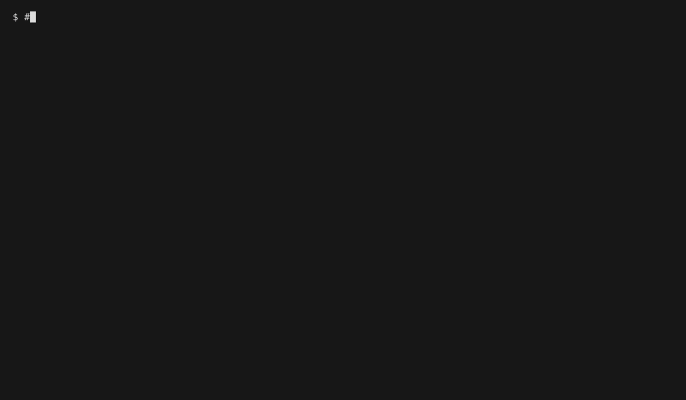

# Let's Go To The Mall

> "Today!"

A pet project to learn TypeScript and NestJS.

## Quick Try With an In-Memory Database

To try the application without creating any file, set `LGTTM_DATABASE_PATH` to `:memory:`.
If you do this, SQLite keeps the database in memory. When the application stops, the data is gone.

```bash
npm run build
LGTTM_DATABASE_PATH=:memory: node dist/main
```



### How the GIF Was Created

The GIF is recorded by [VHS](https://github.com/charmbracelet/vhs). VHS reads a script, called a tape, and replays it in
a terminal.
The tape is `demo.tape`, at the root of the repository.

VHS needs `ttyd` and `ffmpeg` on your `PATH`. To record the GIF again, run this command:

```bash
vhs demo.tape
```

To change the GIF, edit `demo.tape` and run the command again. The tape does these steps:

1. Build the application, hidden from the GIF.
2. Start the application with `LGTTM_DATABASE_PATH=:memory:`.
3. Create a list and read all lists with `curl`.
4. Stop the application.

## Environment Variables

- `LGTTM_SEED_DATA`: set to `true` to seed lists with items when the application starts. Defaults to `false`.
- `LGTTM_DATABASE_PATH`: the path to the SQLite database. Defaults to `working/lgttm.sqlite`.

- `NEST_DEBUG`: set this variable to enable debug logs from the NestJS framework.

## Useful Commands

See `justfile`.

## Endpoint Creation

```bash
nest g resource lists
```

## OpenAPI & Swagger

Just add Swagger to the dependencies:

```bash
npm install @nestjs/swagger
```

Configure it in `main.ts`.

For automatic extraction, configure plugin in `nest-cli.json`:

```json
{
  "compilerOptions": {
    "plugins": [
      {
        "name": "@nestjs/swagger",
        "options": {
          "classValidatorShim": true,
          "introspectComments": true
        }
      }
    ]
  }
}
```

## Docker

```bash
docker compose build
docker compose push

docker compose pull
docker compose up -d
docker compose log -f
```
